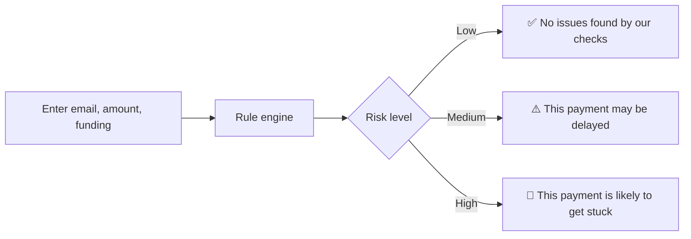
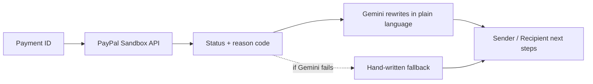
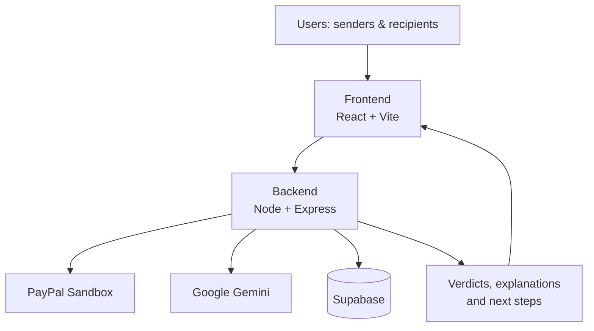

<div align="center">

# 💳 PayWise AI

### Prevent. Detect. Resolve.

**Know before you send. Understand after you pay.**

A plain-language assistant for PayPal payments. It warns you before a payment gets stuck, and explains why, and who has to act, when one already is.

<br>


[**Live Demo**](#-demo) · [**Demo Video**](#-demo) · [**AI Tools Used**](#-ai-tools--how-we-use-them) · [**Run Locally**](#-getting-started) · [**API**](#-api-reference)

</div>

---

> 📸 **Add a screenshot or GIF here.** A 10-second recording of a pre-send check followed by a payment explanation is the single best upgrade to this page.
>
> ``

---

## 📖 Table of Contents

- [The Problem](#-the-problem)
- [The Solution](#-the-solution)
- [Features](#-features)
- [How It Works](#-how-it-works)
- [Demo](#-demo)
- [Tech Stack](#-tech-stack)
- [AI Tools & How We Use Them](#-ai-tools--how-we-use-them)
- [Architecture](#-architecture)
- [Project Structure](#-project-structure)
- [Getting Started](#-getting-started)
- [Environment Variables](#-environment-variables)
- [API Reference](#-api-reference)
- [Testing](#-testing)
- [Security & Privacy](#-security--privacy)
- [Deployment](#-deployment)
- [Known Limits](#-known-limits)
- [More Documents](#-more-documents)
- [Roadmap](#-roadmap)
- [License](#-license)
- [Disclaimer](#-disclaimer)

---

## 😕 The Problem

Digital payments are convenient, but they often get stuck. PayPal shows a label such as **Pending** or **Unclaimed**, and that is where the help ends.

| What users see | What they actually need to know |
|---|---|
| `Pending` | *Why* is it pending? |
| `Unclaimed` | Did I type the wrong email, or does the recipient have no account? |
| `On hold` | Is it my move or theirs? |
| Nothing, before sending | Will this payment even arrive first time? |

Common causes that nobody explains:

- ✉️ A mistyped recipient email
- 👤 The recipient has no PayPal account yet, or it isn't verified
- 🏦 The payment is bank-funded (**eCheck**) and takes days to clear
- 💰 The sender's balance is too low, so PayPal pulls from the bank
- ✋ The recipient must accept the payment manually
- 🌍 Cross-border payments, such as an international client paying a freelancer, are hit hardest

**Senders get no warning before they pay. Recipients get no explanation after.**

## 💡 The Solution

PayWise AI sits on top of PayPal and works in two stages:

| 🟢 Before you send | 🔵 After you send |
|---|---|
| Rule-based checks flag likely risks and give an instant verdict. | Looks up the payment status, then explains the cause in simple language. |
| Warns when a bank-funded payment will be delayed by eCheck. | Gives separate next steps for the **sender** and the **recipient**. |

> **Rules decide, AI explains.** Risk verdicts come from deterministic rules. Gemini only rewrites the result into plain language. It never makes the decision.

---

## ✨ Features

### 1. Pre-Send Payment Check
Enter the recipient's email, amount and funding method. No login needed.

- Email format validation and **typo-domain detection** (`gmial.com` → *"Did you mean diego@gmail.com?"*)
- Amount compared against the balance you enter
- Cross-border flag
- A **Low / Medium / High** verdict with the reasons listed

### 2. Funding Method Warning
Choosing **Bank account** immediately shows that the payment is sent as an eCheck, which usually takes 3–5 business days to clear, and that the recipient can't use the money until then.

### 3. Payment Status Explanation
Paste a payment ID. PayWise fetches the status and reason from the PayPal Sandbox API and translates labels like **Pending**, **Unclaimed**, **On hold** and **Completed** into a clear reason.

### 4. Two-Sided Next Steps
Every explanation shows two columns, side by side:

| Sender should… | Recipient should… |
|---|---|
| What the person who paid needs to do | What the person who is owed needs to do |

If one side has nothing to do, it says so plainly: *"Nothing to do. Wait."*

### 5. AI Explanations with a Safety Net
- Gemini receives **only the PayPal status and reason code**, never an email or name.
- Output is constrained to a fixed format.
- If Gemini is unavailable, a hand-written fallback explanation per reason code is shown instead.

### 6. Live Status Refresh
For payments that aren't completed, the status is polled periodically so the explanation updates without a page reload.

---

## 🔍 How It Works

### Pre-send check



**Example request**

```json
POST /api/check
{
  "recipientEmail": "diego@gmial.com",
  "amount": 250.00,
  "currency": "USD",
  "fundingMethod": "balance",
  "balance": 100.00,
  "senderCountry": "IN",
  "recipientCountry": "MX"
}
```

`fundingMethod` is one of `balance`, `card`, `bank`. The balance and country fields are optional; if left empty, those checks are skipped and the verdict says so.

### Status explanation



### What each status means

| Status | Why | Sender should | Recipient should |
|---|---|---|---|
| Pending, eCheck | Paid from a bank account; the transfer hasn't cleared. | Nothing. Wait. Next time pay by balance or card. | Wait 3–5 business days. |
| Pending, email not confirmed | The email has no confirmed PayPal account. | Check the address. If wrong, cancel and resend. | Add and confirm this exact email in PayPal. |
| Pending, needs acceptance | The account reviews this kind of payment by hand. | Tell the recipient it's waiting. | Open the payment and choose **Accept**. |
| Pending, account not verified | The recipient's account isn't verified yet. | Nothing. Wait. | Finish verification, then accept. |
| Pending, under review | PayPal is reviewing it, usually within 24 hours. | Wait. Answer PayPal if it emails you. | Wait. |
| Pending, international | The recipient's country requires manual acceptance. | Tell the recipient it's waiting. | Open the payment and choose **Accept**. |
| Unclaimed | The recipient hasn't claimed it. | Confirm the address. Unclaimed money returns after 30 days. | Sign up or log in with this exact email. |
| On hold | PayPal paused this payout for review. | Check the PayPal Resolution Centre. | Nothing. Wait. |

---

## 🧪 Demo

| | |
|---|---|
| 🔗 **Hosted demo** | `https://your-app.vercel.app` *(add your link)* |
| 🎥 **Demo video (under 3 min)** | `https://youtu.be/...` *(add your public YouTube link)* |
| 💻 **Run it yourself** | See [Getting Started](#-getting-started) |

**Judges: the 30-second path.** Open the hosted demo → run the pre-send check below → click an example button in *"Why is it stuck?"*. No sign-up, no PayPal account and no real money needed.

**Try a pre-send check**

1. Enter `diego@gmial.com`, amount `250`, paying with **PayPal balance**, balance `100`.
2. Click **Check this payment** and see the typo suggestion and balance warning.
3. Switch to **Bank account** to see the eCheck notice appear instantly.

**Try a payment explanation with no payment ID**

Use these built-in sample IDs in the "Why is it stuck?" panel, or click the example buttons:

| ID | Scenario |
|---|---|
| `DEMO-UNCLAIMED` | Unclaimed payment |
| `DEMO-ECHECK` | Pending eCheck |
| `DEMO-MANUAL` | Pending, needs manual acceptance |
| `DEMO-COMPLETED` | Completed payment |

Demo scenarios are tagged **"Recorded sandbox response"** because some stuck states, eCheck in particular, are hard to produce live in the sandbox. Real lookups need valid sandbox credentials and a real payout ID.

> ⏱️ **Heads up:** the backend is on Render's free tier and may take up to a minute to wake after inactivity. Open the backend URL once before trying the demo.

---

## 🛠️ Tech Stack

| Layer | Technology |
|---|---|
| Frontend | React, Vite, JavaScript |
| Backend | Node.js, Express.js |
| AI | Google Gemini API |
| Payments | PayPal Developer API (Sandbox) |
| Database | Supabase (Postgres), optional |
| Hosting | Vercel (frontend), Render (backend) |
| Tooling | Git, GitHub, Postman |

## 🤖 AI Tools & How We Use Them

| Tool | What it does in PayWise AI |
|---|---|
| **Google Gemini API** (`gemini-2.0-flash`) | Rewrites a PayPal status and reason code into a short, plain-language explanation, with separate "Sender should" and "Recipient should" steps. |
| **PayPal Developer API (Sandbox)** | Supplies the real payment status and reason code that PayWise explains. Read-only: PayWise never sends or receives money. |

**Guardrails on the AI**

- **Gemini never decides risk.** The Low / Medium / High verdict comes from deterministic rules in `checkRules.js`.
- **Minimal input.** Gemini receives only the PayPal status and reason code, with no email, name or amount.
- **Fixed output format,** so it can't wander or invent steps.
- **Fallback.** If Gemini fails or has no key, a hand-written explanation per reason code is shown, and the UI says so.

**AI assistants used while building:** *(list honestly, e.g. ChatGPT and Claude for drafting docs and README, plus any coding assistants you used)*

---

## 🏗️ Architecture



All PayPal and Gemini calls are made **from the backend only**, so no secret ever reaches the browser.

## 📂 Project Structure

```text
paywise-ai/
├── backend/
│   ├── routes/
│   │   ├── auth.js
│   │   ├── check.js          # POST /api/check
│   │   ├── events.js
│   │   ├── payments.js       # GET /api/payments/:id/explain
│   │   └── recipients.js
│   ├── services/
│   │   ├── checkRules.js     # rule engine (no AI)
│   │   ├── explanations.js   # fallback explanation table
│   │   ├── gemini.js         # Gemini wrapper
│   │   └── paypal.js         # PayPal Sandbox client
│   ├── supabase.js
│   ├── server.js
│   └── package.json
├── frontend/
│   ├── public/
│   ├── src/
│   │   ├── App.jsx
│   │   ├── CheckPanel.jsx    # "Before you send"
│   │   ├── StatusPanel.jsx   # "Why is it stuck?"
│   │   ├── api.js
│   │   ├── copy.js           # all interface text
│   │   └── main.jsx
│   ├── index.html
│   ├── vite.config.js
│   └── package.json
├── docs/
├── .env.example
├── .gitignore
└── README.md
```

---

## ⚙️ Getting Started

### Prerequisites

- Node.js v18+ and npm
- Git
- PayPal Developer **Sandbox** credentials
- A Supabase project *(optional)*
- A Google Gemini API key *(optional; fallback explanations work without it)*

### 1. Clone

```bash
git clone https://github.com/rimavishw/paywise-ai.git
cd paywise-ai
```

If you want accounts, saved recipients and simulated transactions, also run [`docs/schema.sql`](docs/schema.sql) in the Supabase SQL editor.

### 2. Backend

```bash
cd backend
npm install
cp ../.env.example .env   # then fill in your values
```

```env
# Supabase (optional, needed for accounts and transactions)
SUPABASE_URL=your_supabase_url
SUPABASE_ANON_KEY=your_supabase_anon_key
SUPABASE_SECRET_KEY=your_supabase_secret_key

# Gemini (optional)
GEMINI_API_KEY=your_gemini_api_key
GEMINI_MODEL=gemini-3.5-flash-lite

# PayPal Sandbox
PAYPAL_CLIENT_ID=your_paypal_client_id
PAYPAL_SECRET=your_paypal_secret
PAYPAL_BASE_URL=https://api-m.sandbox.paypal.com
```

```bash
npm run dev
```

Backend runs at **http://localhost:5050**

### 3. Frontend

In a second terminal:

```bash
cd frontend
npm install
echo "VITE_API_URL=http://localhost:5050" > .env
npm run dev
```

Open **http://localhost:5173**

### Troubleshooting

| Problem | Fix |
|---|---|
| Frontend can't reach the backend | Check `VITE_API_URL` and that the backend is running on port 5050. |
| Explanations look generic | No Gemini key set, so fallback text is being used. This is expected. |
| `429 Too many requests` | Rate limit is 10 requests per minute per IP. Wait a minute. |
| PayPal lookup returns 404 | Use a `DEMO-*` ID, or a real sandbox payout ID. |

---

## ⚙️ Environment Variables

| Name | Required | Used for |
|---|---|---|
| `SUPABASE_URL` | for accounts | Supabase project URL |
| `SUPABASE_ANON_KEY` | for accounts | Sign-up and login |
| `SUPABASE_SECRET_KEY` | for accounts | Server-side database access. Keep it on the backend only |
| `PAYPAL_CLIENT_ID` | yes | PayPal sandbox app client ID |
| `PAYPAL_SECRET` | yes | PayPal sandbox app secret |
| `PAYPAL_BASE_URL` | no | Defaults to `https://api-m.sandbox.paypal.com` |
| `GEMINI_API_KEY` | no | Without it, explanations use the hand-written text |
| `GEMINI_MODEL` | no | Defaults to `gemini-3.5-flash-lite`. Pick a model that answers within the 3 second limit |
| `PORT` | no | Defaults to `5050`. Render sets this itself |
| `VITE_API_URL` | no | Frontend only (`frontend/.env`): backend base URL |

The Supabase values are only needed for accounts, saved recipients and simulated transactions. The pre-send check and payment explanation work without them.

---

## 🔌 API Reference

All bodies and responses are JSON. Routes marked **Auth** need the header `Authorization: Bearer <access_token>`, where the token comes from `POST /api/auth/login`.

| Method | Endpoint | Description |
|---|---|---|
| `GET` | `/` | Backend status |
| `GET` | `/health` | Health check |
| `GET` | `/api/health` | API health check |
| `GET` | `/api/db-test` | Test Supabase connectivity |
| `POST` | `/api/check` | Run a pre-send payment risk check |
| `GET` | `/api/payments/:id/explain` | Fetch and explain a payment's status |

### Health

| Method | Path | Response |
|---|---|---|
| GET | `/` | `{ "message": "PayWise AI Backend is running!", "status": "success" }` |
| GET | `/health` | `{ "status": "ok" }` |
| GET | `/api/health` | `{ "status": "healthy", "service": "PayWise AI" }` |
| GET | `/api/db-test` | 200 if Supabase is reachable, 500 with the error message if not |

### Pre-send check

`POST /api/check` (no auth, 10 requests per minute)

| Field | Required | Rules |
|---|---|---|
| `recipientEmail` | yes | valid email, at most 254 characters |
| `amount` | yes | 0.01 to 60000, at most 2 decimals |
| `currency` | yes | one of `USD EUR GBP INR MXN CAD AUD` |
| `fundingMethod` | yes | `balance`, `card` or `bank` |
| `balance` | no | sender's balance; enables the balance check |
| `senderCountry`, `recipientCountry` | no | both needed for the cross-border check |

```bash
curl -X POST http://localhost:5050/api/check -H "Content-Type: application/json" -d '{"recipientEmail":"friend@gmial.com","amount":"25.00","currency":"USD","fundingMethod":"bank"}'
```

```json
{
  "verdict": "high",
  "reasons": [
    { "code": "EMAIL_TYPO_DOMAIN", "level": "high", "suggestion": "friend@gmail.com" },
    { "code": "FUNDING_BANK_ECHECK", "level": "medium" }
  ],
  "skipped": ["CROSS_BORDER"]
}
```

Reason codes: `EMAIL_TYPO_DOMAIN` (high), `FUNDING_BANK_ECHECK`, `AMOUNT_OVER_BALANCE`, `CROSS_BORDER` (medium). `skipped` lists checks that could not run because optional fields were missing. The verdict is `high` if any reason is high, `medium` if there is any reason at all, otherwise `low`.

Errors: `400` `{ "error": { "code": "validation_error", "fields": [{ "field": "amount", "code": "invalid_amount" }] } }`, `429` `{ "error": { "code": "rate_limited" } }`.

### Payment explanation

`GET /api/payments/:id/explain` (no auth, 10 requests per minute)

`:id` is a PayPal payout batch ID (8–36 letters, digits or hyphens) or one of the demo IDs below.

```json
{
  "paymentId": "DEMO-UNCLAIMED",
  "status": "UNCLAIMED",
  "reasonCode": "UNCLAIMED",
  "statusLabel": "Unclaimed",
  "explanation": "The recipient hasn't claimed it. They may have no PayPal account under this email.",
  "senderSteps": ["Confirm the address. Unclaimed money returns to you after 30 days."],
  "recipientSteps": ["Sign up or log in with this exact email to claim it."],
  "source": "fallback",
  "recorded": true,
  "fetchedAt": "2026-11-12T10:00:00.000Z"
}
```

- `source` is `ai` when Gemini reworded the text and `fallback` when the hand-written text was used.
- `recorded` is `true` for demo IDs and `false` for a live PayPal lookup.
- `status` is one of `COMPLETED`, `UNCLAIMED`, `ONHOLD`, `PENDING`, `OTHER`.

Demo IDs (work without PayPal credentials): `DEMO-UNCLAIMED`, `DEMO-ECHECK`, `DEMO-MANUAL`, `DEMO-COMPLETED`.

Errors: `400` `validation_error` (bad ID format), `404` `not_found` (PayPal has no such payout), `429` `rate_limited`, `502` `paypal_unreachable` (PayPal credentials or API problem).

### Accounts

| Method | Path | Auth | Body | Success |
|---|---|---|---|---|
| POST | `/api/auth/signup` | no | `full_name`, `email`, `password` (8+ characters) | 201 with `user`, `session` |
| POST | `/api/auth/login` | no | `email`, `password` | 200 with `user`, `session` (`session.access_token` is the bearer token) |
| GET | `/api/auth/me` | yes | – | 200 with `user`, `profile` |

### Recipients

| Method | Path | Auth | Body | Success |
|---|---|---|---|---|
| GET | `/api/recipients` | yes | – | 200 with `recipients` |
| POST | `/api/recipients` | yes | `name`, `email` | 201 with `recipient` |
| DELETE | `/api/recipients/:id` | yes | – | 200, or 404 if it is not yours |

### Transactions (simulated)

| Method | Path | Auth | Body | Success |
|---|---|---|---|---|
| POST | `/api/transactions` | yes | `recipient_email`, `amount` (number), `currency` (default `USD`), `note` | 201 with `preflight`, `transaction` |
| GET | `/api/transactions` | yes | – | 200 with `transactions` |
| GET | `/api/transactions/:id` | yes | – | 200 with `transaction`, or 404 |
| GET | `/api/events/transaction/:transactionId` | yes | – | 200 with `events`, or 404 |

`POST /api/transactions` runs a pre-flight check against the sender's profile (saved recipient, verification, sandbox balance). If the check blocks the payment the response is `422` with `status: "blocked"` and the `preflight` details. No real money moves: every transaction is stored with `is_simulated: true`.

These account, recipient and transaction routes answer errors as `{ "status": "error", "message": "..." }`, and `401` when the token is missing or invalid.

---

## 🧪 Testing

Smoke test for every endpoint (plain Node, no test framework):

```bash
cd backend
node scripts/smoke.js
```

Against a deployed backend:

```bash
node scripts/smoke.js https://your-service.onrender.com
```

Set `TEST_EMAIL` and `TEST_PASSWORD` to an existing test user to also run the signed-in flow (profile, recipients, a simulated transaction, events). The check and payments routes allow 10 requests per minute, so wait a minute between runs.

PayPal sandbox check – gets a token, creates a 1.00 USD fake-money payout to a sandbox account, then looks it up directly and through the app:

```bash
node scripts/paypalSandbox.js sandbox-receiver@example.com http://localhost:5050
```

The script refuses to run against anything but the PayPal sandbox. The sandbox app needs the **Payouts** feature switched on (developer.paypal.com → Apps & Credentials → your app → Features).

---

## 🔐 Security & Privacy

- 🔑 Credentials live in environment variables. **Never commit `.env`.**
- 🖥️ PayPal and Gemini are called from the backend only.
- ✅ All inputs are validated on the client and again on the server.
- 🚦 Rate limited to 10 requests per minute per IP.
- 🙈 No login needed for the two main panels, and no tracking cookies. Accounts are optional.
- 🤖 Only the PayPal status and reason code are sent to Gemini, with no email or name attached.
- 🧪 Sandbox only. No real money moves, and PayWise never sends or receives payments.

> ⚠️ Never use real payment credentials in a public repository.

---

## 🚀 Deployment

| Component | Platform |
|---|---|
| Frontend | Vercel |
| Backend | Render |
| Database | Supabase |
| Payments | PayPal Sandbox |
| AI | Google Gemini |

Set `VITE_API_URL` on Vercel to your Render backend URL, and add the backend `.env` values in Render's environment settings.

### Backend on Render (step by step)

1. In Render choose **New → Web Service** and connect this repository.
2. Settings: root directory `backend`, build command `npm install`, start command `npm start`, health check path `/health`. (`render.yaml` holds the same settings if you prefer **New → Blueprint**.)
3. Add the environment variables from the table above. Do not set `PORT`.
4. Deploy, then run the smoke test against the Render URL.
5. Point the frontend at it by setting `VITE_API_URL` to the Render URL.

---

## ⚠️ Known Limits

- CORS is open to every origin. Restrict it to the frontend's address before real use.
- The rate limiter and the explanation cache live in memory, so they reset on restart and are per server instance.
- Only PayPal payout batches can be looked up, and only in the sandbox.
- Transactions are simulated; the app never sends money.

---

## 📚 More Documents

- [Database schema](docs/schema.sql)
- Product requirements, technical requirements and build workflow PDFs are in [`docs/`](docs/)

---

## 🔮 Roadmap

- [x] Rule-based pre-send check
- [x] eCheck / funding warnings
- [x] PayPal Sandbox status lookup with Gemini explanations
- [x] Two-sided next steps with fallback text
- [ ] Transaction history
- [ ] Webhooks in place of polling
- [ ] Sender and recipient dashboards
- [ ] Guide pages for SEO (Pending, Unclaimed, eCheck)
- [ ] Multi-currency logic
- [ ] Spanish version for cross-border recipients
- [ ] Payment analytics

## 🎯 Vision

Make digital payments more transparent, understandable and less stressful, so people spend less time guessing what happened to their money and more time fixing it.

---

## 📄 License

Released under the [MIT License](LICENSE). The license file is in the repository root.

---

## ⚠️ Disclaimer

PayWise AI is an independent hackathon project for demonstration and educational purposes. It is **not affiliated with, endorsed by, or connected to PayPal**. All demos use the PayPal Sandbox, and no real money is transferred. PayWise AI gives guidance, not guarantees, and is not financial advice.

---

<div align="center">

**Built with ❤️ by Team PayWise AI**

*Prevent. Detect. Resolve.*

</div>
