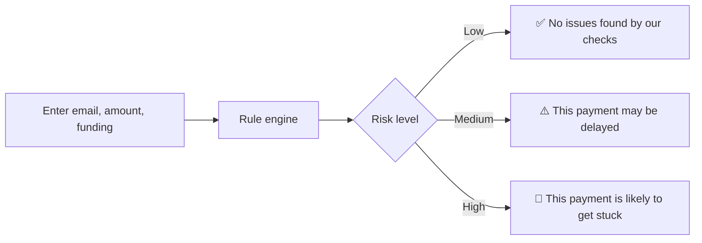
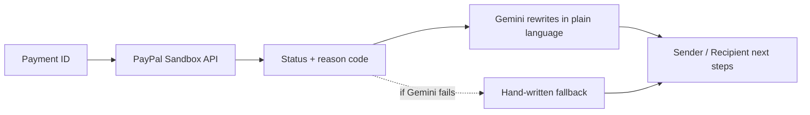
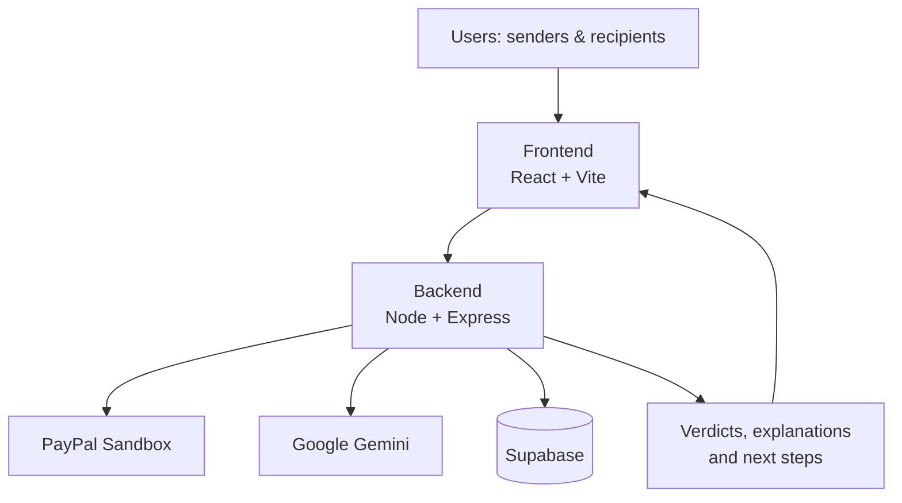

<div align="center">

# 💳 PayWise AI

### Prevent. Detect. Resolve.

**Know before you send. Understand after you pay.**

A plain-language assistant for PayPal payments. It warns you before a payment gets stuck, and explains why, and who has to act, when one already is.

<br>


[**Live Demo**](#-demo) · [**Demo Video**](#-demo) · [**AI Tools Used**](#-ai-tools--how-we-use-them) · [**Run Locally**](#-getting-started) · [**API**](#-api-reference)

</div>

---

> 📸 **Add a screenshot or GIF here.** A 10-second recording of a pre-send check followed by a payment explanation is the single best upgrade to this page.
>
> ``

---

## 📖 Table of Contents

- [The Problem](#-the-problem)
- [The Solution](#-the-solution)
- [Features](#-features)
- [How It Works](#-how-it-works)
- [Demo](#-demo)
- [Tech Stack](#-tech-stack)
- [AI Tools & How We Use Them](#-ai-tools--how-we-use-them)
- [Architecture](#-architecture)
- [Project Structure](#-project-structure)
- [Getting Started](#-getting-started)
- [API Reference](#-api-reference)
- [Security & Privacy](#-security--privacy)
- [Deployment](#-deployment)
- [Roadmap](#-roadmap)
- [License](#-license)
- [Disclaimer](#-disclaimer)

---

## 😕 The Problem

Digital payments are convenient, but they often get stuck. PayPal shows a label such as **Pending** or **Unclaimed**, and that is where the help ends.

| What users see | What they actually need to know |
|---|---|
| `Pending` | *Why* is it pending? |
| `Unclaimed` | Did I type the wrong email, or does the recipient have no account? |
| `On hold` | Is it my move or theirs? |
| Nothing, before sending | Will this payment even arrive first time? |

Common causes that nobody explains:

- ✉️ A mistyped recipient email
- 👤 The recipient has no PayPal account yet, or it isn't verified
- 🏦 The payment is bank-funded (**eCheck**) and takes days to clear
- 💰 The sender's balance is too low, so PayPal pulls from the bank
- ✋ The recipient must accept the payment manually
- 🌍 Cross-border payments, such as an international client paying a freelancer, are hit hardest

**Senders get no warning before they pay. Recipients get no explanation after.**

## 💡 The Solution

PayWise AI sits on top of PayPal and works in two stages:

| 🟢 Before you send | 🔵 After you send |
|---|---|
| Rule-based checks flag likely risks and give an instant verdict. | Looks up the payment status, then explains the cause in simple language. |
| Warns when a bank-funded payment will be delayed by eCheck. | Gives separate next steps for the **sender** and the **recipient**. |

> **Rules decide, AI explains.** Risk verdicts come from deterministic rules. Gemini only rewrites the result into plain language. It never makes the decision.

---

## ✨ Features

### 1. Pre-Send Payment Check
Enter the recipient's email, amount and funding method. No login needed.

- Email format validation and **typo-domain detection** (`gmial.com` → *"Did you mean diego@gmail.com?"*)
- Amount compared against the balance you enter
- Cross-border flag
- A **Low / Medium / High** verdict with the reasons listed

### 2. Funding Method Warning
Choosing **Bank account** immediately shows that the payment is sent as an eCheck, which usually takes 3–5 business days to clear, and that the recipient can't use the money until then.

### 3. Payment Status Explanation
Paste a payment ID. PayWise fetches the status and reason from the PayPal Sandbox API and translates labels like **Pending**, **Unclaimed**, **On hold** and **Completed** into a clear reason.

### 4. Two-Sided Next Steps
Every explanation shows two columns, side by side:

| Sender should… | Recipient should… |
|---|---|
| What the person who paid needs to do | What the person who is owed needs to do |

If one side has nothing to do, it says so plainly: *"Nothing to do. Wait."*

### 5. AI Explanations with a Safety Net
- Gemini receives **only the PayPal status and reason code**, never an email or name.
- Output is constrained to a fixed format.
- If Gemini is unavailable, a hand-written fallback explanation per reason code is shown instead.

### 6. Live Status Refresh
For payments that aren't completed, the status is polled periodically so the explanation updates without a page reload.

---

## 🔍 How It Works

### Pre-send check



**Example request**

```json
POST /api/check
{
  "recipientEmail": "diego@gmial.com",
  "amount": 250.00,
  "currency": "USD",
  "fundingMethod": "balance",
  "balance": 100.00,
  "senderCountry": "IN",
  "recipientCountry": "MX"
}
```

`fundingMethod` is one of `balance`, `card`, `bank`. The balance and country fields are optional; if left empty, those checks are skipped and the verdict says so.

### Status explanation



### What each status means

| Status | Why | Sender should | Recipient should |
|---|---|---|---|
| Pending, eCheck | Paid from a bank account; the transfer hasn't cleared. | Nothing. Wait. Next time pay by balance or card. | Wait 3–5 business days. |
| Pending, email not confirmed | The email has no confirmed PayPal account. | Check the address. If wrong, cancel and resend. | Add and confirm this exact email in PayPal. |
| Pending, needs acceptance | The account reviews this kind of payment by hand. | Tell the recipient it's waiting. | Open the payment and choose **Accept**. |
| Pending, account not verified | The recipient's account isn't verified yet. | Nothing. Wait. | Finish verification, then accept. |
| Pending, under review | PayPal is reviewing it, usually within 24 hours. | Wait. Answer PayPal if it emails you. | Wait. |
| Pending, international | The recipient's country requires manual acceptance. | Tell the recipient it's waiting. | Open the payment and choose **Accept**. |
| Unclaimed | The recipient hasn't claimed it. | Confirm the address. Unclaimed money returns after 30 days. | Sign up or log in with this exact email. |
| On hold | PayPal paused this payout for review. | Check the PayPal Resolution Centre. | Nothing. Wait. |

---

## 🧪 Demo

| | |
|---|---|
| 🔗 **Hosted demo** | `https://your-app.vercel.app` *(add your link)* |
| 🎥 **Demo video (under 3 min)** | `https://youtu.be/...` *(add your public YouTube link)* |
| 💻 **Run it yourself** | See [Getting Started](#-getting-started) |

**Judges: the 30-second path.** Open the hosted demo → run the pre-send check below → click an example button in *"Why is it stuck?"*. No sign-up, no PayPal account and no real money needed.

**Try a pre-send check**

1. Enter `diego@gmial.com`, amount `250`, paying with **PayPal balance**, balance `100`.
2. Click **Check this payment** and see the typo suggestion and balance warning.
3. Switch to **Bank account** to see the eCheck notice appear instantly.

**Try a payment explanation with no payment ID**

Use these built-in sample IDs in the "Why is it stuck?" panel, or click the example buttons:

| ID | Scenario |
|---|---|
| `DEMO-UNCLAIMED` | Unclaimed payment |
| `DEMO-ECHECK` | Pending eCheck |
| `DEMO-COMPLETED` | Completed payment |

Demo scenarios are tagged **"Recorded sandbox response"** because some stuck states, eCheck in particular, are hard to produce live in the sandbox. Real lookups need valid sandbox credentials and a real payout ID.

> ⏱️ **Heads up:** the backend is on Render's free tier and may take up to a minute to wake after inactivity. Open the backend URL once before trying the demo.

---

## 🛠️ Tech Stack

| Layer | Technology |
|---|---|
| Frontend | React, Vite, JavaScript |
| Backend | Node.js, Express.js |
| AI | Google Gemini API |
| Payments | PayPal Developer API (Sandbox) |
| Database | Supabase (Postgres), optional |
| Hosting | Vercel (frontend), Render (backend) |
| Tooling | Git, GitHub, Postman |

## 🤖 AI Tools & How We Use Them

| Tool | What it does in PayWise AI |
|---|---|
| **Google Gemini API** (`gemini-2.0-flash`) | Rewrites a PayPal status and reason code into a short, plain-language explanation, with separate "Sender should" and "Recipient should" steps. |
| **PayPal Developer API (Sandbox)** | Supplies the real payment status and reason code that PayWise explains. Read-only: PayWise never sends or receives money. |

**Guardrails on the AI**

- **Gemini never decides risk.** The Low / Medium / High verdict comes from deterministic rules in `checkRules.js`.
- **Minimal input.** Gemini receives only the PayPal status and reason code, with no email, name or amount.
- **Fixed output format,** so it can't wander or invent steps.
- **Fallback.** If Gemini fails or has no key, a hand-written explanation per reason code is shown, and the UI says so.

**AI assistants used while building:** *(list honestly, e.g. ChatGPT and Claude for drafting docs and README, plus any coding assistants you used)*

---

## 🏗️ Architecture



All PayPal and Gemini calls are made **from the backend only**, so no secret ever reaches the browser.

## 📂 Project Structure

```text
paywise-ai/
├── backend/
│   ├── routes/
│   │   ├── auth.js
│   │   ├── check.js          # POST /api/check
│   │   ├── events.js
│   │   ├── payments.js       # GET /api/payments/:id/explain
│   │   └── recipients.js
│   ├── services/
│   │   ├── checkRules.js     # rule engine (no AI)
│   │   ├── explanations.js   # fallback explanation table
│   │   ├── gemini.js         # Gemini wrapper
│   │   └── paypal.js         # PayPal Sandbox client
│   ├── supabase.js
│   ├── server.js
│   └── package.json
├── frontend/
│   ├── public/
│   ├── src/
│   │   ├── App.jsx
│   │   ├── CheckPanel.jsx    # "Before you send"
│   │   ├── StatusPanel.jsx   # "Why is it stuck?"
│   │   ├── api.js
│   │   ├── copy.js           # all interface text
│   │   └── main.jsx
│   ├── index.html
│   ├── vite.config.js
│   └── package.json
├── docs/
├── .env.example
├── .gitignore
└── README.md
```

---

## ⚙️ Getting Started

### Prerequisites

- Node.js v18+ and npm
- Git
- PayPal Developer **Sandbox** credentials
- A Supabase project *(optional)*
- A Google Gemini API key *(optional; fallback explanations work without it)*

### 1. Clone

```bash
git clone https://github.com/rimavishw/paywise-ai.git
cd paywise-ai
```

### 2. Backend

```bash
cd backend
npm install
cp ../.env.example .env   # then fill in your values
```

```env
# Supabase (optional)
SUPABASE_URL=your_supabase_url
SUPABASE_SECRET_KEY=your_supabase_secret_key

# Gemini (optional)
GEMINI_API_KEY=your_gemini_api_key
GEMINI_MODEL=gemini-2.0-flash

# PayPal Sandbox
PAYPAL_CLIENT_ID=your_paypal_client_id
PAYPAL_SECRET=your_paypal_secret
PAYPAL_BASE_URL=https://api-m.sandbox.paypal.com
```

```bash
npm run dev
```

Backend runs at **http://localhost:5050**

### 3. Frontend

In a second terminal:

```bash
cd frontend
npm install
echo "VITE_API_URL=http://localhost:5050" > .env
npm run dev
```

Open **http://localhost:5173**

### Troubleshooting

| Problem | Fix |
|---|---|
| Frontend can't reach the backend | Check `VITE_API_URL` and that the backend is running on port 5050. |
| Explanations look generic | No Gemini key set, so fallback text is being used. This is expected. |
| `429 Too many requests` | Rate limit is 10 requests per minute per IP. Wait a minute. |
| PayPal lookup returns 404 | Use a `DEMO-*` ID, or a real sandbox payout ID. |

---

## 🔌 API Reference

| Method | Endpoint | Description |
|---|---|---|
| `GET` | `/` | Backend status |
| `GET` | `/health` | Health check |
| `GET` | `/api/health` | API health check |
| `POST` | `/api/check` | Run a pre-send payment risk check |
| `GET` | `/api/payments/:id/explain` | Fetch and explain a payment's status |
| `GET` | `/api/db-test` | Test Supabase connectivity |

---

## 🔐 Security & Privacy

- 🔑 Credentials live in environment variables. **Never commit `.env`.**
- 🖥️ PayPal and Gemini are called from the backend only.
- ✅ All inputs are validated on the client and again on the server.
- 🚦 Rate limited to 10 requests per minute per IP.
- 🙈 No account, login or tracking cookies.
- 🤖 Only the PayPal status and reason code are sent to Gemini, with no email or name attached.
- 🧪 Sandbox only. No real money moves, and PayWise never sends or receives payments.

> ⚠️ Never use real payment credentials in a public repository.

---

## 🚀 Deployment

| Component | Platform |
|---|---|
| Frontend | Vercel |
| Backend | Render |
| Database | Supabase |
| Payments | PayPal Sandbox |
| AI | Google Gemini |

Set `VITE_API_URL` on Vercel to your Render backend URL, and add the backend `.env` values in Render's environment settings.

---

## 🔮 Roadmap

- [x] Rule-based pre-send check
- [x] eCheck / funding warnings
- [x] PayPal Sandbox status lookup with Gemini explanations
- [x] Two-sided next steps with fallback text
- [ ] Transaction history
- [ ] Webhooks in place of polling
- [ ] Sender and recipient dashboards
- [ ] Guide pages for SEO (Pending, Unclaimed, eCheck)
- [ ] Multi-currency logic
- [ ] Spanish version for cross-border recipients
- [ ] Payment analytics

## 🎯 Vision

Make digital payments more transparent, understandable and less stressful, so people spend less time guessing what happened to their money and more time fixing it.

---

## 📄 License

Released under the [MIT License](LICENSE). The license file is in the repository root.

---

## ⚠️ Disclaimer

PayWise AI is an independent hackathon project for demonstration and educational purposes. It is **not affiliated with, endorsed by, or connected to PayPal**. All demos use the PayPal Sandbox, and no real money is transferred. PayWise AI gives guidance, not guarantees, and is not financial advice.

---

<div align="center">

**Built with ❤️ by Team PayWise AI**

*Prevent. Detect. Resolve.*

</div>
